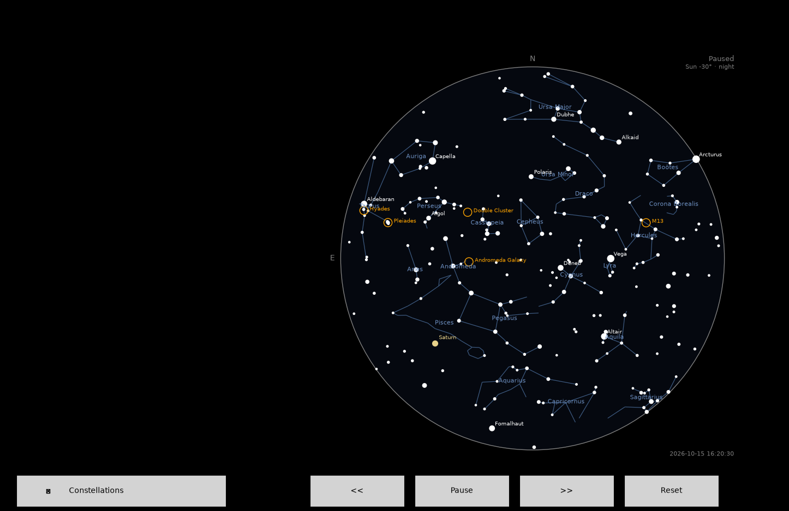

# Night Sky Tracker

Live, interactive sky chart in Python: stars, constellations, named stars,
star clusters, the Sun, Moon, planets, and the ISS for any location and time,
with time controls.



## Features
- Naked-eye stars from the Hipparcos catalog, with named stars and constellation lines (toggleable)
- Sun, Moon (with illuminated %), and the five naked-eye planets
- Sky brightness follows the Sun's altitude (day, twilight, night)
- ISS position, 90-minute track, and upcoming passes
- Live updating, plus rewind / fast-forward / pause / reset

## Install and run
```
pip install -r requirements.txt
python sky_tracker.py --lat 51.48 --lon -0.0015
```
First run downloads about 70MB of data (star catalog, planetary ephemeris, ISS orbit).
Tested on Python 3.14.7.

## How it works
Every object ends up as an (altitude, azimuth) pair for your location and time,
then gets projected onto a disc (centre = straight up, edge = horizon).
- Stars: catalog RA/Dec converted to alt/az by Skyfield
- Planets, Sun, Moon: JPL DE421 ephemeris
- ISS: SGP4 propagation of a Celestrak TLE
[1-2 sentences on the time/clock design]

## Validation
- **ISS:** predicted passes were checked against Heavens-Above and matched.
- **Constellations:** figures and positions were checked against Stellarium and matched.

## Limitations
- ISS accuracy degrades with distance from the TLE epoch, so it is hidden beyond 3 days
- No atmospheric refraction
- Marker sizes are not to scale; Moon shows illumination %, not a drawn phase
- Planets are hidden when the Sun is above -3 degrees, a simplification
- Ephemeris covers 1899 to 2053
- Aircraft tracking is not implemented

## Data sources
Hipparcos catalog (via Skyfield), JPL DE421 ephemeris, Celestrak (ISS orbital elements),
Stellarium (constellation line data). Built with Skyfield, NumPy, pandas, Matplotlib.

## License
MIT